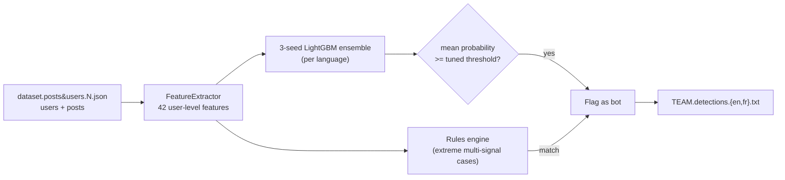
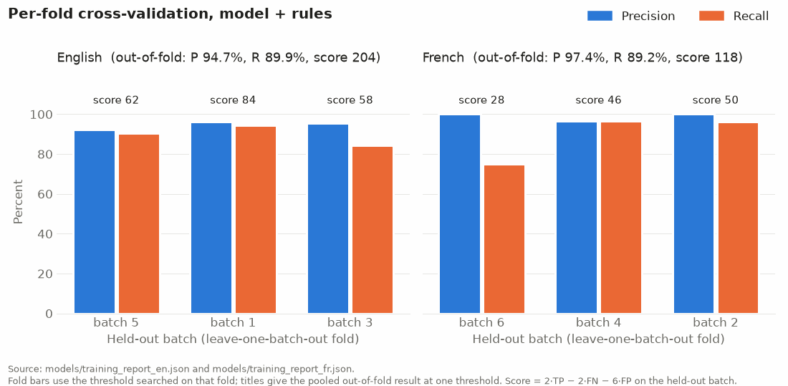

<p align="center">
  <picture>
    <source media="(prefers-color-scheme: dark)" srcset="assets/logo-animated-dark.svg">
    
  </picture>
</p>

<p align="center">
  
  <a href="https://github.com/mo-dev-x/social-bot-detection-ml/commits/main"></a>
  
</p>

<p align="center">
  <a href="#the-problem">The problem</a> ·
  <a href="#how-it-works">How it works</a> ·
  <a href="#results">Results</a> ·
  <a href="#quickstart">Quickstart</a> ·
  <a href="#project-structure">Project structure</a> ·
  <a href="#limitations-and-next-steps">Limitations</a>
</p>

<p align="center">
  <picture>
    <source media="(prefers-color-scheme: dark)" srcset="assets/divider-dark.svg">
    
  </picture>
</p>

A behavior-based pipeline that classifies social media accounts as bots or humans, using per-language LightGBM ensembles tuned for a scoring rule that punishes false positives three times harder than misses.

**10th of 25 on the French detector leaderboard** of the Bot or Not competition (March 2026). Built solo, competing as SignalGuard.

## The problem

Each competition batch is a JSON dump of accounts and their posts, in English or French. The goal is to submit the list of user IDs that are bots. Submissions are scored as:

```text
score = 2 * TP - 2 * FN - 6 * FP
```

Flagging one human costs as much as missing three bots, so flagging an account only pays off when the model is more than 75% sure it is a bot (6 / (2 + 6)). The dataset has no follower graph, likes or retweets, so everything has to come from posting behavior and the profile.

The approach:

- **User-level classification.** All of an account's posts are combined into one feature row. A single post says little; the pattern across dozens of posts gives the bot away.
- **Behavior over meaning.** Timing, bursts, repetition and templating are much harder for a bot to fake than natural-sounding text. The project uses no embeddings, sentiment or topic models.
- **One model per language.** English and French get separate models, hyperparameters and thresholds.
- **Thresholds chosen for the competition score.** Decision thresholds are picked to maximize the score on out-of-fold predictions, not set at 0.5.

## How it works



### Features (`src/feature_extraction.py`)

There are 42 numeric features per user. Features with near-zero variance are dropped automatically before training; `tweet_count_gap_ratio` was dropped this way in the final run.

| Group | Features |
|---|---|
| Timing (15) | mean / std / min / max / variance / coefficient of variation of time between posts, `periodic_interval_ratio`, `successive_delay_ratio`, `min_rolling_cv`, `hour_entropy`, `hour_uniform_chi2`, `night_activity_ratio`, `tweets_per_hour`, `burst_ratio_1h`, `burst_ratio_extreme` |
| Text statistics (8) | `avg_tweet_length`, `std_tweet_length`, `type_token_ratio`, `unique_words_ratio`, `top10_word_concentration`, `accent_density`, `semantic_consistency`, `word_length_variance` |
| Repetition and coordination (9) | `duplicate_tweet_ratio`, TF-IDF cosine `avg_similarity_between_tweets` / `max_similarity`, `near_duplicate_ratio`, `template_duplicate_ratio`, `template_top_ratio`, `cross_user_repost_ratio`, `batch_coordination_score`, `topic_focus_ratio` |
| Profile (5) | `username_length`, `digit_ratio`, `username_entropy`, `bio_length`, `has_description` |
| Activity (5) | `tweet_count`, `observed_post_count`, `tweet_count_gap_ratio`, `z_score`, `tweet_time_span` |

### Model (`src/model_training.py`)

- `LGBMClassifier` with small, regularized trees: 180 estimators for English and 160 for French, a learning rate of 0.05, and L2 regularization. The French model uses `class_weight="balanced"`.
- Each language model is a **3-seed ensemble** (seeds 42, 777, 2026) whose probabilities are averaged. This reduced the few very confident false positives that single runs produced.
- A **rules engine** (`src/rules_engine.py`) also flags accounts with extreme combinations of signals, such as near-duplicate posts plus heavy bursts, or coordinated reposts plus templated text. An account is flagged if the model **or** a rule flags it. The rules are deliberately strict so they add almost no false positives.

### Evaluation

- **Leave-one-batch-out cross-validation** uses `GroupKFold` grouped by batch. English trains on batches 1, 3 and 5; French trains on 2, 4 and 6. Each fold tests on a batch the model has never seen, which is the situation the final evaluation batch creates.
- The threshold is searched over 140 values (from 0.50 to 0.99 for English, 0.30 to 0.99 for French) on the out-of-fold probabilities, using the competition score as the objective.

## Results

> [!NOTE]
> These are out-of-fold cross-validation results from the reports committed in [`models/`](models/), with the model and rules combined. They are not final leaderboard numbers.

| Language | Users | Bots | Score | Precision | Recall | False positives | Threshold |
|---|---|---|---|---|---|---|---|
| English | 945 | 158 | **204** | 94.7% | 89.9% | 8 | 0.539 |
| French | 626 | 83 | **118** | 97.4% | 89.2% | 2 | 0.667 |

Score on each held-out batch: English 62 / 84 / 58, French 28 / 46 / 50. Every fold scores positive, so the models carry over to batches they did not see. On its own, the rules engine flags only 1 English and 9 French accounts (with 1 and 0 false positives); it is a safety net, not the main detector.

<p align="center">
  
</p>
<p align="center"><sub>Plotted from the committed <code>models/training_report_en.json</code> and <code>models/training_report_fr.json</code> (leave-one-batch-out CV, model + rules). The trained <code>.pkl</code> models are not in the repo, so no feature-importance plot is shown.</sub></p>

Full per-fold and threshold details are in [`models/training_report_en.json`](models/training_report_en.json) and [`models/training_report_fr.json`](models/training_report_fr.json).

## Quickstart

> [!IMPORTANT]
> Requires **Python 3.11**. The pinned versions (`numpy==1.24.3`, `pandas==2.0.3`) do not install on Python 3.12 or newer.

```bash
git clone https://github.com/mo-dev-x/social-bot-detection-ml.git
cd social-bot-detection-ml
python3.11 -m venv .venv
source .venv/bin/activate        # Windows: .venv\Scripts\activate
pip install -r requirements.txt

python test_comprehensive.py     # environment and pipeline checks (runs without data)
```

### Data

> [!NOTE]
> The competition datasets are **not included** (`data/` is gitignored).

Put them here:

```text
data/
├── training/              # labeled batches 1-6
│   ├── dataset.posts&users.1.json
│   ├── dataset.bots.1.txt
│   └── ...
├── evaluation_samples/    # optional extra labeled samples (batches 30, 31)
└── final_eval/            # unlabeled final drop
```

Each JSON file has top-level `users` and `posts` keys. Posts link to users through `author_id`. Each `dataset.bots.N.txt` lists one bot user ID per line.

### Train

```bash
python test_everything.py        # checks that the data loads and features build
python model_training.py         # trains EN and FR models
```

This writes `models/model_{en,fr}.pkl`, `models/threshold_{en,fr}.pkl` and `models/training_report_{en,fr}.json`.

### Detect

```bash
python final_submission.py \
  --en-dataset data/final_eval/final_eval_en.json \
  --fr-dataset data/final_eval/final_eval_fr.json
```

This writes `submissions/SignalGuard.detections.en.txt` and `.fr.txt`, with one flagged user ID per line. Use `--team-name` to change the prefix.

> [!TIP]
> Pass the dataset paths explicitly: without them, the script looks for `dataset.posts&users.30.json` and `.31.json` inside `--dataset-dir`.

To run one dataset on its own:

```bash
python -m src.detector path/to/dataset.json submissions/out.txt --language fr --team-name demo
```

## Project structure

```text
.
├── src/
│   ├── feature_extraction.py   # FeatureExtractor: users + posts -> 42 features per user
│   ├── model_training.py       # training, GroupKFold CV, threshold search, inference
│   ├── rules_engine.py         # conservative rule-based safety layer
│   ├── detector.py             # CLI for a single dataset
│   └── utils.py                # loading, tokenizing, entropy, timestamp helpers
├── models/                     # training reports (*.json); trained *.pkl are gitignored
├── documentation/
│   ├── ARCHITECTURE_DECISIONS.md   # ADRs: why user-level, why LightGBM, why no NLP, ...
│   └── PROJECT_TRACKER.md          # phase-by-phase progress and deferred ideas
├── model_training.py           # entry point: train both languages
├── final_submission.py         # entry point: generate submission files
├── feature_extraction.py       # re-exports from src/
├── test_everything.py          # quick data-readiness check
└── test_comprehensive.py       # 8-step environment and pipeline check
```

The design reasoning, including the approaches that were tried and rejected, is in [ARCHITECTURE_DECISIONS.md](documentation/ARCHITECTURE_DECISIONS.md).

## Tests

> [!NOTE]
> `test_comprehensive.py` and `test_everything.py` are plain scripts, not a pytest suite.

Without data, they check imports, rule logic and the submission file format, and they skip the steps that need data or models. With `data/training/` present, they also run feature extraction end to end.

## Limitations and next steps

- **Small validation set.** There are only 3 labeled batches per language, so each language has 3 cross-validation folds. Estimates are noisy, and the organizers said the final batch would include some new bot strategies.
- **Not reproducible without the competition data**, which this repo cannot redistribute.
- **`models/training_report_global.json` is out of date.** It comes from an earlier single-model setup (batches 30 and 31, older paths) and does not describe the shipped pipeline.
- Ideas deferred in the tracker: SHAP-based feature selection, probability calibration (Platt scaling), one model per batch with voting, and a lower threshold floor for French.

## Author

Built solo by [Mohamed El Yazid El Yaakoubi](https://github.com/mo-dev-x).

## License

Released under the [MIT License](LICENSE).
